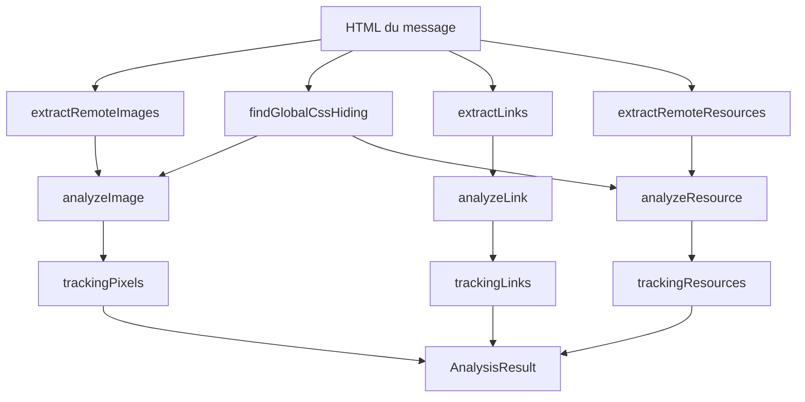

# Fonctionnement de la détection

Ce document explique en profondeur comment l'extension détecte les pixels de
suivi, dans le but de permettre à un développeur d'améliorer le projet. Il décrit
le pipeline, les règles de décision exactes, les limites connues et la marche à
suivre pour ajouter une nouvelle technique.

## 1. Principe fondamental : analyse statique uniquement

L'extension **ne charge jamais** de contenu distant. Toute l'analyse porte sur le
source HTML du message, récupéré via `messenger.messages.getFull()`. Charger une
image, un `iframe` ou une ressource distante reviendrait à prévenir le serveur de
suivi que l'email a été ouvert — c'est exactement ce que l'on veut empêcher.

Le moteur est **pur** : `detectTrackingThreats(html: string)` ne dépend d'aucune
API Thunderbird et ne fait que de l'analyse de texte. Il est donc testable
unitairement sans environnement d'extension.

## 2. Vue d'ensemble du pipeline



Point d'entrée : `detectTrackingThreats(html)` dans `src/lib/detector.ts`.

```ts
export function detectTrackingThreats(html: string): AnalysisResult {
    const images = extractRemoteImages(html);
    const globalCssReason = findGlobalCssHiding(html);
    const trackingPixels = images
        .map((image) => analyzeImage(image, globalCssReason))
        .filter((pixel): pixel is TrackingPixel => pixel !== null);
    const trackingLinks = extractLinks(html)
        .map(analyzeLink)
        .filter((link): link is TrackingLink => link !== null);
    const trackingResources = extractRemoteResources(html)
        .map((resource) => analyzeResource(resource, globalCssReason))
        .filter((resource): resource is TrackingResource => resource !== null);

    return {
        remoteImageCount: images.length,
        trackingPixels,
        trackingLinks,
        trackingResources,
    };
}
```

Chaque famille (images, liens, ressources) suit le même schéma :
**extraire → analyser → filtrer**. Une URL dupliquée n'est analysée qu'une fois
par famille (déduplication par `Set`).

## 3. Les modèles de données

Définis dans `src/models/tracking.ts` et ré-exportés par `src/lib/detector.ts`
(pour ne pas casser les imports du background et du popup).

| Type | Rôle |
| --- | --- |
| `AnalysisResult` | Résultat complet : `remoteImageCount`, `trackingPixels`, `trackingLinks`, `trackingResources`, `readReceiptRequested?`, `error?` |
| `TrackingPixel` | Image suspecte : `url`, `width`, `height`, `reasons` |
| `TrackingLink` | Lien de clic suspect : `url`, `reasons` |
| `TrackingResource` | Ressource non-image suspecte : `url`, `width`, `height`, `reasons` |

Le champ `reasons` est une liste de chaînes **en français**, affichées telles
quelles dans le popup. C'est la justification que l'utilisateur voit : toute
nouvelle technique doit produire des raisons explicites.

## 4. Famille 1 : les pixels de suivi (images)

### 4.1 Extraction — `extractRemoteImages(html)`

Sont extraits :

- les balises `` : attribut `src` (avec `width`/`height` et `style`) ;
- les images à chargement différé : attributs `srcset`, `data-src` et
  `data-original` (l'URL réelle n'est pas dans `src`) ;
- les images de fond CSS : `style="background-image: url(…)"` sur n'importe
  quelle balise.

Sont ignorées : les URLs non distantes (`cid:` et `data:` sont rejetées par
`isRemoteUrl`) et les doublons d'URL.

### 4.2 Analyse — `analyzeImage(image, globalCssReason)`

Les indices collectés :

1. **Dimension 1×1 px** : `width === 1 && height === 1` (via les attributs ou
   le CSS). Raison : `"Image de 1×1 px"`.
2. **Masquage CSS** : `display: none`, `visibility: hidden`, `opacity: 0` ou
   dimensions CSS ≤ 1. Raisons : `"Masquée par CSS (display: none)"` ou
   `"Masquée par CSS global (…)"` (voir section 8).
3. **Nom de fichier suspect** : `pixel.gif`, `beacon.png`, `spacer.gif`…
   (liste `PIXEL_FILE_NAMES`). Raison : `"Nom de fichier suspect (pixel.gif)"`.
4. **Indices d'URL** : mot-clé de suivi dans le domaine/chemin, ou paramètres
   de suivi. Raisons : `"Domaine ou chemin lié au suivi"`,
   `"Paramètres de suivi (open, mid)"` (voir section 7).

### 4.3 Règle de décision

```ts
const isSuspicious =
    isOneByOne ||          // image 1×1
    hiddenReason !== null || // image masquée par CSS
    fileName !== null ||     // nom de fichier typique
    reasons.length >= 2;     // ou au moins deux indices combinés
```

Un seul indice d'URL (ex. un paramètre `utm_*`) ne suffit **pas** : c'est un
usage marketing courant, pas une preuve de suivi. Les indices sont combinés pour
réduire les faux positifs tout en attrapant les trackers sans nom de fichier
typique ni dimension 1×1.

## 5. Famille 2 : les liens de suivi des clics

### 5.1 Extraction — `extractLinks(html)`

Extrait les `href` des balises `<a>` qui pointent vers un serveur distant,
dédupliqués.

### 5.2 Analyse — `analyzeLink(url)`

Les indices collectés :

1. **Chemin de redirection** : `/click/…`, `/track/…`, `/trk/…`, `/redirect/…`
   dans le chemin de l'URL. Raison : `"Chemin de redirection"`.
2. **Domaine de redirection** : le domaine contient `click`, `track`, `trk`,
   `redirect`, `go` ou `mailer` (liste `CLICK_WORDS`). Raison :
   `"Domaine de redirection"`.
3. **Paramètre de redirection** : `?url=…`, `?redirect=…`, `?goto=…`…
   (liste `REDIRECT_PARAMS`). Raison : `"Paramètre de redirection (url)"`.
4. **Paramètres de suivi** : même liste que pour les images (section 7).
   Raison : `"Paramètres de suivi (campaign_id)"`.

### 5.3 Règle de décision

```ts
if (reasons.length < 2) return null;
```

**Deux indices minimum**, contrairement aux images : un lien avec seulement
`?utm_source=` est courant dans toute newsletter légitime, tandis qu'un
click-tracker réunit presque toujours au moins deux indices (domaine `click.*`
**et** paramètre `url=`, ou chemin `/track/` **et** paramètre de suivi).

## 6. Famille 3 : les ressources distantes non-image

### 6.1 Extraction — `extractRemoteResources(html)`

Parcourt les balises `RESOURCE_TAGS` :

```ts
const RESOURCE_TAGS = [
    "iframe", "frame", "link", "embed", "object",
    "video", "audio", "source", "track",
];
```

L'URL est lue dans `src` ou `href` selon la balise, avec `width`/`height`/`style`
quand ils existent. Un beacon peut être porté par n'importe quel élément qui
déclenche un téléchargement — pas seulement une image.

### 6.2 Analyse — `analyzeResource(resource, globalCssReason)`

Exactement les mêmes règles que pour les images (section 4.2), avec une seule
différence de libellé : `"Dimension 1×1 px"` au lieu de `"Image de 1×1 px"`.

## 7. Famille 4 : les accusés de réception (hors HTML)

Ce n'est pas un pixel, mais **une confirmation d'ouverture sans pixel** : le
client mail (ex. Outlook) envoie un accusé à l'expéditeur quand le message est
ouvert. Détecté dans les **en-têtes MIME** de la partie racine, pas dans le HTML :

```ts
const READ_RECEIPT_HEADERS = [
    "return-receipt-to",
    "disposition-notification-to",
];
```

`readReceiptRequested(part)` renvoie `true` si l'un de ces en-têtes existe avec
au moins une valeur. Le background l'ajoute au résultat de
`detectTrackingThreats` (le HTML ne contient pas ces en-têtes).

## 8. Les listes de mots-clés et constantes

Toutes les listes vivent en tête de `src/lib/detector.ts`. C'est là qu'on ajoute
un mot-clé ou un paramètre observé sur une nouvelle plateforme.

| Constante | Contenu | Utilisée par |
| --- | --- | --- |
| `TRACKING_WORDS` | `track`, `tracking`, `pixel`, `beacon`, `open`, `click`, `email`, `newsletter`, `campaign`, `mailer`, `esp`, `trk` | Mots-clés du domaine/chemin des images et ressources |
| `TRACKING_PARAMS` | `open`, `open_id`, `track`, `tracking`, `trk`, `tid`, `mid`, `message_id`, `uid`, `campaign`, `campaign_id`, `email`, `token`, `recipient`, `subscriber`, `signature`, `rid`, `cid`, `utm_source`, `utm_medium`, `utm_campaign`, `utm_term`, `utm_content` | Paramètres d'URL de suivi (images, liens, ressources) |
| `REDIRECT_PARAMS` | `url`, `redirect`, `redirect_url`, `redirect_to`, `dest`, `destination`, `target`, `goto`, `next`, `continue`, `return`, `ref`, `link` | Paramètres de redirection des liens de clic |
| `CLICK_WORDS` | `click`, `track`, `trk`, `redirect`, `go`, `mailer` | Domaines de redirection des liens de clic |
| `RESOURCE_TAGS` | `iframe`, `frame`, `link`, `embed`, `object`, `video`, `audio`, `source`, `track` | Balises non-image analysées |
| `PIXEL_FILE_NAMES` | `pixel`, `beacon`, `spacer`, `clear`, `blank`, `transparent`, `1x1`, `open`, `track`, `tracking`, `pix`, `px`, `dot` | Noms de fichiers typiques d'un pixel |

La recherche de mots-clés est une simple **sous-chaîne** (`hostname.includes`),
volontairement tolérante : elle peut sur-signaler, mais le popup affiche les
raisons pour que l'utilisateur juge.

## 9. Les helpers clés

| Helper | Rôle |
| --- | --- |
| `getAttribute(tag, name)` | Lit un attribut HTML (`name="…"`, `name='…'` ou `name=…`) via une regex avec lookbehind `(?<![\w-])` |
| `extractSrcsetUrls(srcset)` | Décompose `"url 1x, url 2x"` en URLs |
| `parseDimension(value)` | Convertit `"1"` ou `"1px"` en `1`, sinon `null` |
| `cssDimension(style, property)` | Valeur numérique d'une propriété CSS (ex. `width: 1px` → `1`) |
| `hasCssDeclaration(style, prop, value)` | Vérifie `prop: value` suivi de `;`, `!` ou de la fin |
| `cssHiddenReason(style)` | Détecte `display: none`, `visibility: hidden`, `opacity: 0`, dimensions ≤ 1 ; renvoie le détail pour l'afficher |
| `inlineCssHiddenReason(style)` | Idem, formaté `"Masquée par CSS (…)"` |
| `findGlobalCssHiding(html)` | Cherche dans les blocs `<style>` une règle ciblant `img`/`iframe` avec une déclaration masquante ; renvoie `"Masquée par CSS global (…)"` |
| `stripMediaQueries(css)` | Retire les blocs `@media` (accolades comptées) : cacher des éléments sur mobile est un usage responsive légitime |
| `isRemoteUrl(url)` | `http(s)://` ou protocole relatif `//` |
| `parseUrl(url)` | `new URL` sans exception ; préfixe `https:` pour les URLs `//…` |
| `suspiciousFileName(url)` | Nom de fichier (sans extension) dans `PIXEL_FILE_NAMES` |
| `hostContainsWord(url, words)` | Mot-clé dans le domaine |
| `urlContainsWord(url, words)` | Mot-clé dans le domaine **ou** le chemin |
| `urlTrackingReasons(url)` | Regroupe mot-clé de domaine/chemin + paramètres de suivi (partagé images/ressources) |
| `findUrlParams(url, names)` | Noms des paramètres d'URL présents (comparaison en minuscules) |

## 10. Intégration Thunderbird (`src/background/background.ts`)

1. **Scan automatique** : `messenger.messageDisplay.onMessagesDisplayed` se
   déclenche à chaque affichage de message ; un debounce de **300 ms** évite de
   relancer l'analyse pendant la navigation entre messages.
2. **Récupération du corps** : `messenger.messages.getFull(header.id)` puis
   `findHtmlBody(part)` qui descend récursivement dans les parties
   `multipart/*` pour trouver la partie `text/html`.
3. **Analyse** : `detectTrackingThreats(html)` + `readReceiptRequested(message)`.
4. **Indicateurs** (`updateBadge`) :
   - icône de la barre d'outils : badge rouge avec le nombre de menaces
     (`pixels + liens + ressources`), rien si 0 ;
   - bouton d'en-tête du message (`messageDisplayAction`) : badge toujours
     visible — vert `0` si sûr, rouge avec le compte sinon ; label `Sûr` /
     `Accusé de réception` / `N menace(s)` ; titre explicatif au survol.
   - un accusé de réception compte comme une alerte (`needsAttention`) même sans
     pixel : c'est une confirmation d'ouverture.
5. **Popup** : à l'ouverture, il envoie `runtime.sendMessage({ type:
   "ANALYZE_CURRENT_MESSAGE" })`. Le background répond avec le résultat, en
   retrouvant le message via `mailTabs.query` + `getDisplayedMessages` (le popup
   n'a pas accès à `onMessagesDisplayed`). Le popup affiche ensuite les sections
   par famille et la raison de chaque signalement (tout est échappé via
   `escapeHtml` : les URLs viennent d'emails potentiellement hostiles).

## 11. Les tests (`src/lib/detector.test.ts`)

35 tests Vitest, répartis en trois groupes :

- **`detectTrackingThreats`** (~26 tests) : un test **positif** et, quand c'est
  pertinent, un test **négatif** (pas de faux positif) pour chaque technique —
  pixel 1×1, fond CSS, paramètres d'URL, image légitime, `cid:`/`data:` ignorés,
  newsletter réaliste, masquages CSS (inline, global, `@media` ignoré),
  `data-src`, `srcset`, URLs protocole-relatives, liens de clic, iframes,
  embeds, feuille de style légitime…
- **`readReceiptRequested`** (4 tests) : les deux en-têtes détectés, et les deux
  cas « sans en-tête » → `false`.
- **`findHtmlBody`** (5 tests) : HTML simple, `multipart/alternative`,
  `multipart/mixed` imbriqué, absence de partie HTML, partie sans corps.

Commande : `pnpm test`.

## 12. Limites connues (choix assumés)

La détection est **heuristique** et a des angles morts, tous documentés ici pour
que personne ne promette plus que ce que le code fait :

- **Pas de blocklist de domaines** : les études publiques montrent ~30 % de
  ratés avec cette approche ; la détection par indices est plus robuste.
- **Sur-signalement possible** : une sous-chaîne (`track`, `open`…) peut matcher
  un contenu légitime. C'est assumé : chaque signalement affiche ses raisons.
- **Pas de ML / pas d'analyse du rendu** : on travaille uniquement sur le source,
  ce qui est un choix de confidentialité (aucun chargement) mais empêche de
  détecter un tracker sans aucun indice textuel.
- **Pas de décodage d'entités HTML** dans les URLs extraites : une URL encodée
  (`&amp;`) n'est pas normalisée avant analyse.
- **Pas de trim des espaces internes** d'une URL : `extractSrcsetUrls` découpe
  sur les virgules et les espaces, mais une URL contenant des espaces ne sera
  pas analysée (elle échoue à `parseUrl` et retombe sur les autres indices).
- **`list-style-image` CSS non couvert** : une image de liste (utilisée par
  certains trackers) n'est pas extraite.
- **Analyse au premier message affiché seulement** : en vue multi-onglets ou
  avec plusieurs messages affichés, seul `displayedMessages[0]` est analysé.

## 13. Guide : améliorer la détection

### Ajouter un mot-clé, un paramètre ou une balise (le cas le plus courant)

1. Ouvrir `src/lib/detector.ts` et repérer la liste concernée
   (`TRACKING_WORDS`, `TRACKING_PARAMS`, `REDIRECT_PARAMS`, `CLICK_WORDS`,
   `RESOURCE_TAGS`, `PIXEL_FILE_NAMES`).
2. Ajouter le terme. Une nouvelle balise de `RESOURCE_TAGS` est automatiquement
   extraite et analysée par `extractRemoteResources`.
3. Ajouter un test positif (et un test négatif si possible) dans
   `detector.test.ts`, en français.
4. Valider : `pnpm test` puis `pnpm exec biome check .`.

### Ajouter une nouvelle technique de détection (ex. `list-style-image`)

1. **Extraire** : ajouter une fonction d'extraction (ou enrichir une existante)
   qui produit les entrées nécessaires — le pattern est
   `extractRemoteImages` / `extractRemoteResources` (déduplication par `Set`,
   rejet via `isRemoteUrl`).
2. **Analyser** : soit réutiliser `analyzeImage`/`analyzeResource`, soit créer
   un analyseur dédié. Toute décision doit produire des **raisons en français**
   explicites.
3. **Brancher** le nouvel analyseur dans `detectTrackingThreats` et l'ajouter
   au résultat (`AnalysisResult`) si c'est une nouvelle famille de menaces.
4. **Modèle** : si un nouveau type est nécessaire, le définir dans
   `src/models/tracking.ts` et le ré-exporter depuis `detector.ts`.
5. **Badge/popup** : mettre à jour le comptage dans `updateBadge`
   (`background.ts`) et le rendu des sections dans `main.ts` (popup).
6. **Tests** : un test positif + un test négatif par technique.
7. Valider : `pnpm test` → `pnpm exec biome check .` → `pnpm build` →
   `pnpm tb:lint` (0 erreur, warnings connus tolérés). Commit conventionnel
   atomique (`feat:`).

### Rappel des conventions

- Le moteur reste **pur** (aucune API Thunderbird dans `detector.ts`).
- Les raisons affichées sont **en français**, courtes et explicites.
- Les types vivent dans `src/models/`, ré-exportés par `detector.ts`.
- On ne charge **jamais** un contenu distant, même pour vérifier.
