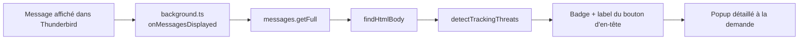

# Thunderbird Pixel Detector

Extension Thunderbird qui détecte les pixels de suivi (web beacons) dans les emails
et alerte l'utilisateur, **sans jamais charger les contenus distants**.

> ⚠️ **Principe fondamental** : l'analyse se fait uniquement sur le source HTML du
> message (via `messages.getFull`). Aucun ``, `iframe` ou autre ressource
> distante n'est téléchargé : le charger reviendrait à confirmer au serveur de
> suivi que l'email a été ouvert.

## Fonctionnalités

- **Pixels de suivi classiques** : `` de 1×1 px, nom de fichier suspect
  (`pixel.gif`, `beacon.png`…), masquage CSS (`display: none`, `opacity: 0`…).
- **Images de fond CSS** : `style="background-image: url(…)"`.
- **Images à chargement différé** : `srcset`, `data-src`, `data-original`.
- **Liens de suivi des clics** : domaine `click.*`, chemin `/track/click/…`,
  paramètres de redirection (`?url=…`, `?redirect=…`).
- **Ressources distantes non-image** : `iframe`, `frame`, `link`, `embed`,
  `object`, `video`, `audio`, `source`, `track`.
- **Accusés de réception** : en-têtes `Return-Receipt-To` et
  `Disposition-Notification-To` (une confirmation d'ouverture sans pixel).
- **Indicateurs visuels** : badge sur le bouton d'en-tête du message (vert « 0 »
  si sûr, rouge avec le nombre de menaces sinon) et popup détaillant chaque
  signalement avec sa **raison**.

## Prérequis

- Node.js récent (20+ recommandé)
- pnpm

## Installation (développement)

```sh
pnpm install
pnpm build
```

Le résultat est généré dans `dist/`.

### Installer l'extension dans Thunderbird

1. Dans Thunderbird : `Ctrl+Maj+A` (Gestionnaire de modules complémentaires) →
   menu ⚙️ → **Déboguer les modules complémentaires**.
2. **Charger un module complémentaire temporaire…** → sélectionner
   `dist/manifest.json`.
3. Après chaque modification : `pnpm build`, puis cliquer **Recharger** dans
   le gestionnaire de débogage.

## Commandes

| Commande | Rôle |
| --- | --- |
| `pnpm test` | Lance les tests Vitest (35 tests) |
| `pnpm exec biome check .` | Lint + vérification du format |
| `pnpm build` | Compile TypeScript (`tsc --noEmit`) + build Vite vers `dist/` |
| `pnpm tb:lint` | `build` + lint `web-ext` de `dist/` (0 erreur attendu) |
| `pnpm tb:build` | Génère un XPI signable dans `artifacts/` |
| `pnpm release:patch` / `release:minor` / `release:major` | Incrémente la version + génère le XPI |
| `pnpm dev` | Serveur de développement Vite (utile pour la mise en forme du popup) |

> Note : `web-ext lint` remonte 4 warnings connus, sans erreur :
> l'absence de la permission `data_collection_permissions` et deux usages
> d'`innerHTML` (toujours échappés via `escapeHtml` avant insertion).

## Structure du projet

```
public/
  manifest.json          Manifeste de l'extension (MV3, permission messagesRead)
  icons/                 Icônes 16/32/48/64 px
src/
  background/
    background.ts        Orchestration : scan à l'affichage, badge, réponses au popup
  lib/
    detector.ts          Moteur de détection (pur, sans API Thunderbird) + ré-export des types
    detector.test.ts     35 tests Vitest du moteur
  models/
    tracking.ts          Types du domaine : AnalysisResult, TrackingPixel, TrackingLink, TrackingResource
  popup/
    index.html           Page du popup
    main.ts              Rendu du popup (appel au background via runtime.sendMessage)
    style.css            Styles du popup
  types/
    thunderbird.d.ts     Types minimaux des API Thunderbird (mailTabs, messageDisplay, messages…)
  content/
    content.ts           Réservé, inutilisé pour l'instant
```

Les fichiers `src/style.css`, `src/assets/*` et `src/node_modules/` sont des
vestiges du template Vite (non référencés par le code de l'extension).

## Architecture



Le moteur `detectTrackingThreats` est **pur** : il ne touche qu'à des chaînes
HTML et ne dépend d'aucune API Thunderbird. Il est donc testable unitairement
sans environnement d'extension.

## Validation avant commit

```sh
pnpm test
pnpm exec biome check .
pnpm build
pnpm tb:lint
```

Conventions : TypeScript strict, indentation par tabulations, guillemets doubles,
commentaires et messages en français, commits conventionnels atomiques
(`feat:`, `fix:`, `refactor:`, `test:`, `docs:`, `chore:`).

## Limites connues

La détection est **heuristique** : elle s'appuie sur des indices (dimensions,
CSS, noms de fichiers, mots-clés d'URL) et peut **sur-signaler** des contenus
légitimes. Chaque signalement affiche ses raisons pour que l'utilisateur juge.
Elle peut en revanche laisser passer des trackers qui ne laissent aucun indice
dans le source (ex. image légitime réutilisée comme beacon). Le détail complet,
les seuils et les pistes d'amélioration sont dans [DETECTION.md](DETECTION.md).

## Documentation de la détection

[DETECTION.md](DETECTION.md) explique tout le fonctionnement de la détection
(familles de menaces, règles de décision, helpers, limites) pour un développeur
qui souhaite améliorer le projet.
